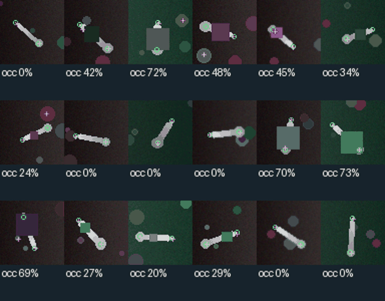
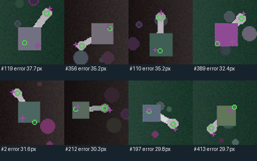
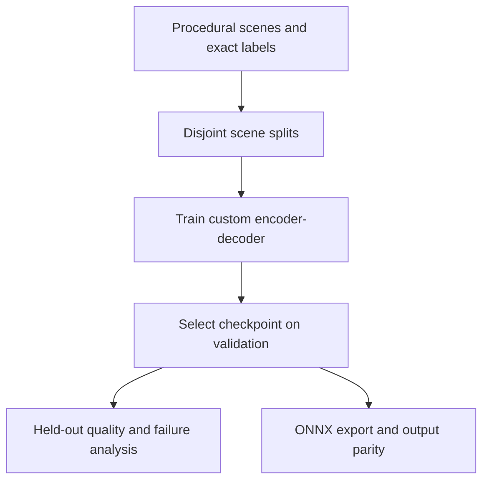

# Occlusion-aware tool localization

[](https://github.com/amersaidi2002-byte/occlusion-aware-tool-localization/actions)

A small **PyTorch model trained from scratch** for visible tool segmentation and
tip/base localization under occlusion. The repository includes a procedural
dataset, a threshold/PCA baseline, an augmentation ablation, validation-selected
checkpoints, an ONNX export and automated tests.

**Personal research prototype, November 2026. All images are synthetic. No
clinical or real-robot validation.** The objective is to make the research and
deployment workflow inspectable, not claim surgical-system performance.



## Measured results

<!-- RESULTS_START -->
| Split | Method | Mean IoU | PCK@5 px | Mean keypoint error |
| --- | --- | ---: | ---: | ---: |
| test | threshold/PCA | 0.836 | 75.7% | 5.01 px |
| test | custom network | 0.912 | 80.9% | 5.11 px |
| test | no augmentation | 0.824 | 80.4% | 6.99 px |
| shape_shift | threshold/PCA | 0.854 | 57.8% | 5.40 px |
| shape_shift | custom network | 0.931 | 94.9% | 1.67 px |
| shape_shift | no augmentation | 0.875 | 90.7% | 2.93 px |

Each split contains 480 synthetic images. One training seed, 16 epochs per trial;
checkpoint selection uses validation loss only. The network improves segmentation
and PCK on the standard split, but its mean keypoint error is slightly worse than
the simple baseline because some predictions fail badly. See the failure gallery.

PyTorch/ONNX validation parity: max absolute logit error `2.67e-05` over 16 images.

Full metrics, occlusion bins and confidence coverage: [main report](results/main_report.json).
The confidence threshold is validation-derived and is not a calibrated safety score.
<!-- RESULTS_END -->

### Failure analysis



Heavy occlusion and distractors can send a keypoint far from the tool. This is
why both average error and PCK are reported, rather than only the better-looking
metric. Confidence gating is analyzed in the JSON report; it is not a substitute
for real-world validation.

## Run it

Tested on Linux x86-64, Python 3.12 and PyTorch 2.5.1 CPU. No dataset download or
GPU is needed.

```bash
python -m venv .venv
source .venv/bin/activate
pip install torch==2.5.1 --index-url https://download.pytorch.org/whl/cpu
pip install -e '.[dev]'
pytest -q
python -m toolloc.experiment --output runs/main --epochs 16 \
  --train 1200 --val 240 --test 480 --threads 2
python -m toolloc.experiment --output runs/no_augmentation --epochs 16 \
  --train 1200 --val 240 --test 480 --threads 2 --no-augmentation
```

Use the committed model without retraining:

```bash
python -m toolloc.predict --model artifacts/main/model.onnx \
  --image results/example_input.png --output runs/prediction
```

Outputs include JSON coordinates, a segmentation mask and an overlay. The input
contract is deliberately fixed to RGB 64x64; any resizing must preserve an
explicit mapping back to source coordinates.



## What to inspect

- [`synthetic.py`](src/toolloc/synthetic.py): geometry, labels, seeds and occlusion.
- [`model.py`](src/toolloc/model.py): architecture, losses and decoding.
- [`experiment.py`](src/toolloc/experiment.py): training, checkpoint selection,
  confidence gating, evaluation, export and audit hashes.
- [`EXPERIMENT_DESIGN.md`](docs/EXPERIMENT_DESIGN.md): methodology and limitations.
- [`results/`](results/): actual reports, per-image measurements and visualization.
- [`artifacts/main/`](artifacts/main/): trained checkpoint, ONNX model and example tensors.

The companion [robotic ML evaluation harness](https://github.com/amersaidi2002-byte/robotic-ml-evaluation-harness)
tests deployment contracts and Python/C++ inference with this exact ONNX graph.

CI runs lint, unit tests and a one-epoch training/export smoke test. A Dockerfile
is supplied for CPU training; Docker execution was not available in the authoring
environment. Development used AI coding assistance; all reported measurements
come from executed experiments.
